  

# Hi, I'm Khanh 👋

### 🛡️ Cybersecurity Student • Blue Team • SOC & DFIR • Malware Analysis

Building hands-on detection labs, automated malware analysis engines,  
and privacy-preserving local AI orchestrators for Incident Response.

---

## 👨‍💻 About Me

- 🎓 **Information Security Student** passionate about Blue Team operations, SOC Tier 1/2 workflows, and Incident Response.
- 🔬 **Malware & Forensic Tooling:** Specializing in static & dynamic document analysis, deobfuscation, YARA rule engineering, and memory forensics.
- 🤖 **SecOps Automation:** Developing air-gapped, on-premises AI orchestrators to automate alert triage, correlation, and MITRE ATT&CK mapping.
- 🧪 **Enterprise Detection Labs:** Hands-on experience configuring Wazuh SIEM/XDR, Splunk Enterprise, Snort 3 NIDS, Sysmon, and Active Directory environments.
- ✍️ **Technical Publishing:** Regularly publishing malware writeups, network traffic decryption analyses, and lab blueprints on my personal blog.

---

## 🛠️ Security Stack & Technologies

### 🔒 Security Operations, SIEM & IDS

### 💻 Operating Systems & Scripting

### ⚙️ Development, Web & Cloud

---

## 🚀 Featured Engineering & Research Projects

### 1. 📑 [PDF Static Advanced Security Analyzer (`pdf_analysts`)](https://github.com/kh4nhc4nh/pdf_analysts)
An isolated, distributed client-server static analysis engine built on FastAPI (Ubuntu) and a lightweight Windows CLI client.
- **What it does:** Performs strict zero-execution static analysis on weaponized PDFs—reconstructing QPDF object reference graphs, deobfuscating embedded JavaScript streams, verifying real MIME types vs spoofed extensions, and scanning with ClamAV and YARA.
- **Key Feature:** Generates a dual-tier report (condensed JSON with 91.7% noise reduction and a clean 2-page vector PDF) tailored for both non-technical managers (plain-language risk) and SOC analysts (exact Object IDs, hierarchy paths, triggers, and MITRE ATT&CK mapping).
- **Tech Stack:** `Python` • `FastAPI` • `QPDF` • `YARA` • `ClamAV` • `ReportLab`
- ➡️ [**Explore Repository**](https://github.com/kh4nhc4nh/pdf_analysts)

---

### 2. 🛡️ [ARGUS-SOC: Autonomous Local AI Orchestrator for Wazuh SIEM](https://github.com/kh4nhc4nh/Autonomous-Local-AI-Orchestrator-Incident-Response)
An autonomous, air-gapped AI SOC Tier-1 analyst designed to automate security alert triage directly on-premises.
- **What it does:** Ingests real-time alerts from Wazuh Indexer every 3s, filters out ~85% of telemetry noise, maintains a 5-minute sliding correlation window to track multi-stage attacks, and uses a local air-gapped LLM (`Ollama Qwen2.5:3b`) to reason through adversary intent without cloud data leaks.
- **Key Feature:** Evaluates True/False positives, maps attacks to MITRE ATT&CK, and pushes structured emergency response playbooks directly to Telegram.
- **Tech Stack:** `Wazuh SIEM` • `Ollama (Local LLM)` • `Sysmon` • `Python` • `Telegram Bot API`
- ➡️ [**Explore Repository**](https://github.com/kh4nhc4nh/Autonomous-Local-AI-Orchestrator-Incident-Response)

---

### 3. 🦠 [Hybrid SOC Malware Behavior Detection Lab](https://github.com/kh4nhc4nh/wazuh-snort-malware-behavior-detection-lab)
A multi-layered defensive security lab simulating and detecting malware-like activities across both endpoint and network tiers without using live malware.
- **What it does:** Uses automated PowerShell simulations to trigger periodic HTTP beaconing, C2 communication patterns (`/beacon`, `/c2`), fake payload downloads, and DNS lookups in an isolated network.
- **Key Feature:** Implements custom Wazuh rules (`local_rules.xml`) correlating Sysmon Process Creation (Event ID 1) with Network Connections (Event ID 3), alongside custom Snort 3 NIDS rules (`local.rules`) detecting beaconing signatures.
- **Tech Stack:** `Wazuh Manager` • `Snort 3 NIDS` • `Sysmon` • `PowerShell` • `Network Forensics`
- ➡️ [**Explore Repository**](https://github.com/kh4nhc4nh/wazuh-snort-malware-behavior-detection-lab)

---

### 4. 📊 [Enterprise Active Directory Detection Lab with Splunk & Sysmon](https://github.com/kh4nhc4nh/ad-splunk)
A corporate Active Directory defense environment designed for collecting, forwarding, and investigating identity-based attacks.
- **What it does:** Deploys a dedicated Windows Server Domain Controller (`mydfir.local`), domain-joined Windows 10 endpoint, Splunk Enterprise server, and an isolated Kali Linux attacker machine on a dedicated `192.168.10.0/24` subnet.
- **Key Feature:** Forwards Windows Security logs and Sysmon telemetry via Splunk Universal Forwarder to hunt Kerberos ticket abuse, brute-force logon attempts (Event ID 4625), unauthorized user creation (Event ID 4720), and LOLBIN execution via tailored SPL queries.
- **Tech Stack:** `Splunk Enterprise` • `Active Directory (AD DS)` • `Sysmon` • `Windows Event Forwarding` • `SPL`
- ➡️ [**Explore Repository**](https://github.com/kh4nhc4nh/ad-splunk)

---

### 5. 🔎 [DFIR Enterprise Home Lab with Wazuh + Sysmon Telemetry](https://github.com/kh4nhc4nh/dfir-wazuh-home-lab)
A dedicated digital forensics and incident response environment tailored for real-time endpoint monitoring and detection engineering.
- **What it does:** Collects deep kernel-level telemetry from Windows 10 endpoints using custom `sysmonconfig.xml` rules combined with full PowerShell Script Block Logging and Transcription.
- **Key Feature:** Features custom detection rules for Living-off-the-Land Binaries (LOLBINs), Base64-encoded PowerShell payloads (`-EncodedCommand`), and unauthorized process spawning visualized on OpenSearch dashboards.
- **Tech Stack:** `Wazuh 4.x` • `OpenSearch` • `Sysmon 15.x` • `PowerShell Script Block Logging`
- ➡️ [**Explore Repository**](https://github.com/kh4nhc4nh/dfir-wazuh-home-lab)

---

## 🌐 Deployed Security Web Applications

Interactive, cloud-deployed security platforms hosted on Vercel for live malware investigation:

| Web Platform | Primary Capability & Analysis Scope | Live Access |
| :--- | :--- | :---: |
| **Dynamic Malware Analysis & Incident Reporting Platform** | Automated web portal for ingesting suspicious samples, tracking runtime behavioral indicators, inspecting C2 network communication, and generating forensic reports. | [🔗 **Launch App**](https://webreportdynamicanalystsmalware.vercel.app/) |
| **Malware Research & Threat Intelligence Hub** | Centralized web interface for malware artifact cataloging, searchable IOC indexing (SHA-256, domains, IPs), and defensive research documentation. | [🔗 **Launch App**](https://kh4nhc4nhmalware.vercel.app/) |

---

## ✍️ Featured Technical Blog: JosKhanh Blog

**SOC Analysis • Incident Response • Deep Packet Inspection • Threat Hunting**

My personal technical publication platform dedicated to sharing real-world forensic investigations, protocol reverse engineering, and threat detection writeups:

- 🔍 **Deep Network & C2 Traffic Decryption:** Practical walkthroughs analyzing `.pcapng` traffic in Wireshark, dissecting Command & Control communications, and extracting cryptographic keys (e.g., *Analyzing and Decrypting Havoc C2 Traffic: From Wireshark to AES-CTR Key Extraction*).
- 🧩 **Malware & CVE Forensic Case Studies:** End-to-end log analyses investigating web server exploitation artifacts (`access.log`), CVE vulnerability triggers (e.g., CVE-2020-14115), and adversary staging techniques.
- 📘 **Blue Team Blueprints & Detection Cheat-Sheets:** Step-by-step guides on configuring SIEM correlation rules, Sysmon schemas, and defensive home laboratories.

👉 **Read the latest investigations:** [**kh4nhc4nh.github.io**](https://kh4nhc4nh.github.io)

---

## 📊 GitHub Statistics

---

## 🎯 Current Focus & Learning Path

- 🛡️ **SOC Operations & Incident Handling:** Advancing Tier-2 alert triage, root cause analysis (RCA), and incident containment.
- 🔍 **Detection Engineering:** Creating customized YARA rules, Sigma rules, and Wazuh/Splunk correlation logic against modern evasion methods.
- 🧪 **Malware Reverse Engineering:** Static disassembly (Ghidra/IDA) and behavioral sandbox tracing.
- 🤖 **Agentic SecOps Automation:** Implementing local AI workflows to lower MTTD (Mean Time to Detect) and MTTR (Mean Time to Respond).
- 💼 **Career Goal:** Aspiring to work as a **SOC Analyst**, **Detection Engineer**, or **DFIR Specialist** in a proactive Blue Team.

---

## 📫 Connect With Me

- 🌐 **Technical Blog:** [kh4nhc4nh.github.io](https://kh4nhc4nh.github.io)
- 💻 **GitHub:** [github.com/kh4nhc4nh](https://github.com/kh4nhc4nh)
- 🚀 **Dynamic Malware Analysis App:** [webreportdynamicanalystsmalware.vercel.app](https://webreportdynamicanalystsmalware.vercel.app/)
- 🧪 **Malware Research Hub:** [kh4nhc4nhmalware.vercel.app](https://kh4nhc4nhmalware.vercel.app/)

---

### Thanks for stopping by! Let's connect and build a safer digital world. 🛡️✨

