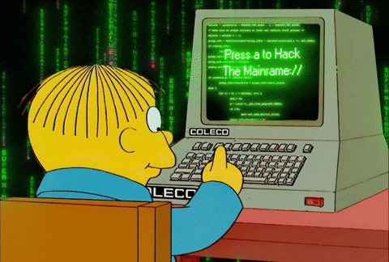

  

# Hi, I'm Khanh 👋

### 🛡️ Cybersecurity Student • Blue Team • SOC & DFIR • Malware Analysis

Building hands-on cybersecurity labs, automated detection pipelines,  
malware analysis platforms, and AI-driven incident response orchestrators.

---

## 👨‍💻 About Me

- 🎓 **Information Security Student** with a strong passion for Defensive Security.
- 🔐 **Core Interests:** Blue Team Operations, SOC Analysis (Tier 1/2), DFIR, Detection Engineering, and Malware Reverse Engineering.
- 🔬 **Malware & Forensics:** Specializing in static & dynamic document analysis (PDF/Office), behavior analysis, YARA rule authoring, and memory forensics.
- 🤖 **Security Automation & AI:** Designing on-premises, privacy-preserving Local AI orchestrators to assist SOC analysts in triaging alerts and automating playbook response.
- 🧪 **Hands-on Labs:** Actively building and maintaining detection labs with Wazuh SIEM/XDR, Splunk Enterprise, Snort IDS, and Active Directory environments.
- 📝 **Knowledge Sharing:** Publishing technical writeups, laboratory blueprints, and security toolings on my portfolio and GitHub repositories.

---

## 🛠️ Technologies & Security Stack

### 🔒 Security Operations & SIEM / IDS

### 💻 OS & Scripting

### ⚙️ Development, Web & Cloud Deployment

---

## 🚀 Featured Projects

### 🔬 1. Malware Analysis Platforms & Specialized Tooling

#### 📑 [PDF Static Advanced Security Analyzer (`pdf_analysts`)](https://github.com/kh4nhc4nh/pdf_analysts)
A dedicated, isolated static analysis engine for malicious and weaponized PDFs.
- **Key Capabilities:** Zero-execution isolation on Ubuntu, QPDF object-graph reconstruction, deobfuscation (Octal/Base64/Hex stream decoding), YARA & ClamAV scanning, and embedded file extraction.
- **Dual-Tier Reporting:** Generates condensed JSON (91.7% noise reduction) and professional 2-page vector PDF reports structured specifically for both **Non-Technical Management** (Executive risk summary) and **SOC Analysts** (Exact Object IDs, Catalog reference paths, trigger mechanisms, and IR playbooks).
- ➡️ [View Repository](https://github.com/kh4nhc4nh/pdf_analysts)

---

#### 🌐 [Web Dynamic Malware Analysts & Reporting Platform](https://webreportdynamicanalystsmalware.vercel.app/)
An automated web-based dynamic malware analysis platform deployed on Vercel.
- **Key Capabilities:** Streamlined web interface for ingesting samples, tracking runtime execution telemetry, visualizing network C2 callbacks, and compiling comprehensive incident investigation reports.
- 🔗 **Live Demo:** [webreportdynamicanalystsmalware.vercel.app](https://webreportdynamicanalystsmalware.vercel.app/)
- ➡️ [View Repository](https://github.com/kh4nhc4nh/web_report_dynamic_analysts_malware)

---

#### 🧪 [Malware Research & Analysis Hub (`kh4nhc4nh.malware`)](https://kh4nhc4nhmalware.vercel.app/)
A modern cloud-deployed portal dedicated to malware research, artifact repository, and IOC indexing.
- **Key Capabilities:** Centralized web dashboard for malware classification, IOC tracking (hashes, domains, IPs), behavioral artifact analysis, and searchable threat intelligence notes.
- 🔗 **Live Demo:** [kh4nhc4nhmalware.vercel.app](https://kh4nhc4nhmalware.vercel.app/)
- ➡️ [View Repository](https://github.com/kh4nhc4nh/kh4nhc4nh.malware)

---

### 🤖 2. Autonomous AI for Incident Response

#### 🧠 [Autonomous Local AI Orchestrator for Incident Response](https://github.com/kh4nhc4nh/Autonomous-Local-AI-Orchestrator-Incident-Response)
An autonomous, privacy-preserving local AI security orchestrator built to empower SOC analysts.
- **Key Capabilities:** Executes locally without exposing confidential enterprise logs or telemetry to public cloud APIs. Ingests security alerts, correlates multi-source SIEM/EDR events, queries internal knowledge bases, and dynamically generates actionable containment and mitigation playbooks based on MITRE ATT&CK.
- ➡️ [View Repository](https://github.com/kh4nhc4nh/Autonomous-Local-AI-Orchestrator-Incident-Response)

---

### 🏰 3. Hands-on SOC, DFIR & Detection Engineering Labs

#### 🔎 [DFIR Wazuh Enterprise Home Lab](https://github.com/kh4nhc4nh/dfir-wazuh-home-lab)
A comprehensive DFIR laboratory for endpoint telemetry collection, root-cause investigation, and threat hunting practice using Wazuh SIEM/XDR.
- ➡️ [View Repository](https://github.com/kh4nhc4nh/dfir-wazuh-home-lab)

#### 🦠 [Wazuh–Snort Malware Behavior Detection Lab](https://github.com/kh4nhc4nh/wazuh-snort-malware-behavior-detection-lab)
Hybrid network and endpoint threat detection environment correlating Snort network signatures with Wazuh endpoint behavioral telemetry.
- ➡️ [View Repository](https://github.com/kh4nhc4nh/wazuh-snort-malware-behavior-detection-lab)

#### 📊 [Active Directory Security & Splunk Telemetry Lab](https://github.com/kh4nhc4nh/ad-splunk)
Enterprise Windows Active Directory attack lab focused on harvesting Sysmon and Windows Event logs, designing custom Splunk detection dashboards, and tracking Kerberos/NTLM attacks.
- ➡️ [View Repository](https://github.com/kh4nhc4nh/ad-splunk)

#### 🌐 [Personal Cybersecurity Portfolio & Research Notes](https://kh4nhc4nh.github.io)
My technical portfolio showcasing detailed laboratory writeups, research papers, and defensive security cheat-sheets.
- 🔗 **Website:** [kh4nhc4nh.github.io](https://kh4nhc4nh.github.io)

---

## 📊 GitHub Statistics

---

## 🎯 Current Objectives & Learning Path

- 🛡️ **SOC Operations & Incident Response:** Deepening Tier 2/3 investigation skills, root-cause analysis, and enterprise containment.
- 🔍 **Detection Engineering:** Creating customized YARA rules, Sigma detection rules, and Wazuh/Splunk correlation searches for modern evasion techniques.
- 🧪 **Malware Reverse Engineering:** Advancing static disassembly (Ghidra/IDA) and dynamic sandbox tracing.
- 🤖 **SecOps Automation:** Developing local agentic workflows that reduce Mean Time to Detect (MTTD) and Mean Time to Respond (MTTR).
- 💼 **Career Goal:** Aspiring to work as a **SOC Analyst**, **Detection Engineer**, or **DFIR Specialist** in a proactive Blue Team environment.

---

## 📫 Connect With Me

- 🌐 **Portfolio Website:** [kh4nhc4nh.github.io](https://kh4nhc4nh.github.io)
- 💻 **GitHub Profile:** [github.com/kh4nhc4nh](https://github.com/kh4nhc4nh)
- 🚀 **Live Malware Analysis Portal:** [kh4nhc4nhmalware.vercel.app](https://kh4nhc4nhmalware.vercel.app/)
- 📑 **Dynamic Report Web App:** [webreportdynamicanalystsmalware.vercel.app](https://webreportdynamicanalystsmalware.vercel.app/)

---

### Thanks for visiting my profile! Let's connect and build a safer cyberspace. 🛡️✨

